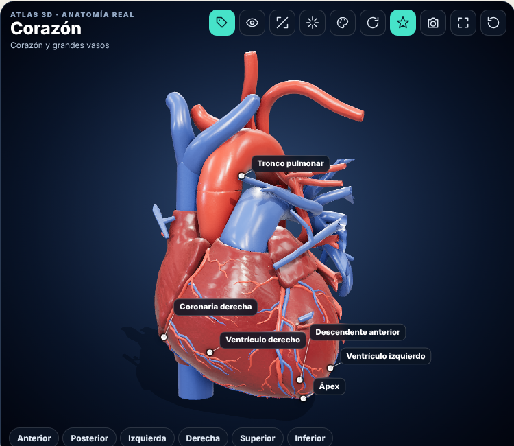

# Ruta R1 · Campus médico

Aplicación de estudio para el examen de residencia (R1) en un solo archivo HTML: `Ruta_R1_Campus.html`.
Ábrelo en Chrome, Edge, Safari o Firefox recientes. Tu progreso se guarda en el navegador.

## Novedades

### Atlas 3D con anatomía real
- **331 estructuras reales** derivadas de resonancia (BodyParts3D), simplificadas y empaquetadas dentro del HTML.
- **8 modelos**: corazón y grandes vasos (con coronarias, venas cardíacas, válvulas y músculos papilares), encéfalo (giro por giro, núcleos, ventrículos, tronco y cerebelo), tórax (lóbulos pulmonares, árbol bronquial, caja torácica, diafragma), abdomen (vísceras, riñones, vasos), cráneo (huesos, dientes y encéfalo opcional), mano y muñeca, vía visual y un bloque de piel esquemático con melanoma.
- **Renderizado realista**: materiales físicos de tejido húmedo (barniz, brillo, microrrelieve), iluminación de estudio, sombras suaves y oclusión ambiental (modo calidad alta).
- **Herramientas**: etiquetas, rayos X, corte coronal/sagital/axial (muestra cavidades y válvulas), despiece, colores didácticos, aislar, ocultar o hacer transparente cada estructura, opacidad por grupo, vistas anatómicas, autorrotación, captura de pantalla y pantalla completa.
- **Correlación clínica** para cada estructura (y por cámara en la pared cardíaca).
- **Quiz 3D**: "Señalar" e "Identificar" con mejor marca guardada.
- **"Ver en Atlas 3D"** desde la explicación de preguntas con imagen (ECG, TAC, radiografías, fondo de ojo, piel).
- Importación de modelos propios **OBJ, STL y GLB/GLTF** (se procesan en el dispositivo).

### Arena: salas sin Firebase (como en Lunami)
- Crea una sala y comparte el **código de 6 caracteres**; sin cuentas ni configuración.
- Dos caminos a la vez: **conexión directa** (WebRTC con PeerJS) y **relevo MQTT público cifrado** (AES-GCM con clave derivada del código; EMQX, HiveMQ y Mosquitto) cuando el directo no conecta.
- El anfitrión es la fuente de verdad: chat de espera, cronómetro sincronizado, respuestas, resultados y reanudación si alguien recarga la página.
- Firebase queda solo como opción avanzada.

### Imágenes clínicas reales
- Las ilustraciones simuladas se reemplazaron por **imágenes reales con licencia libre** (Wikimedia Commons): ECG de IAM inferior y de hiperpotasemia, TAC de hematoma epidural y subdural, neumoperitoneo, fractura de Colles, signo del campanario, oclusión de la arteria central de la retina y melanoma. Cada imagen muestra su autor y licencia.
- Donde no había imagen real adecuada, la pregunta describe los hallazgos en el texto.

### Banco de preguntas ampliado
- **1003 casos clínicos, al menos 100 por especialidad**: cirugía general, cirugía plástica, ginecología y obstetricia, medicina interna, ortopedia, neurocirugía, toxicología, pediatría, oftalmología y dermatología.
- Casos clínicos originales con explicación paso a paso, por qué no las otras opciones, perla para memorizar, tarjeta de repaso y fuente.
- Quienes ya usaban la app reciben las preguntas nuevas automáticamente, sin perder su historial.

### Simulación clínica
- **ECG de 12 derivaciones realistas** (modelo fisiológico por derivación, papel milimetrado, tira de ritmo): IAM inferior con cambios recíprocos, hiperpotasemia con T picudas y cardiotoxicidad por tricíclicos con QRS ancho.
- **Monitor de signos vitales en vivo** en el Hospital virtual: ECG (II) con la morfología del caso, pletismografía, respiración y sonido opcional.

## Requisitos
- El motor 3D (three.js) se descarga de `cdn.jsdelivr.net` la primera vez: se necesita internet. Sin conexión se muestra la vista 3D básica anterior.
- WebGL 2 y un navegador con `DecompressionStream` (Chrome 80+, Safari 16.4+, Firefox 113+).

## Créditos y licencias
- Imágenes clínicas: Wikimedia Commons (James Heilman MD, Frank Gaillard, Jpogi, Bill Rhodes, Ashish j29, A. Fieß et al., M.-J. F. Agbayani y E. Gonzales, National Cancer Institute) con licencias CC BY, CC BY-SA o dominio público, indicadas junto a cada imagen.
- Salas: [PeerJS](https://peerjs.com) (MIT) y brokers MQTT públicos.
- Mallas anatómicas: **BodyParts3D**, © The Database Center for Life Science, licencia [CC BY-SA 2.1 Japón](https://creativecommons.org/licenses/by-sa/2.1/jp/deed.es). Mitsuhashi N, et al. *BodyParts3D: 3D structure database for anatomical concepts.* Nucleic Acids Res. 2009;37:D782-5. Obtenidas de [Kevin-Mattheus-Moerman/BodyParts3D](https://github.com/Kevin-Mattheus-Moerman/BodyParts3D); se simplificaron, recortaron y comprimieron. Las mallas adaptadas se comparten bajo la misma licencia.
- [three.js](https://threejs.org) r169 y el decodificador de [meshoptimizer](https://github.com/zeux/meshoptimizer): licencia MIT.
- Contenido educativo: no sustituye el juicio clínico, el estudio en cadáver ni la imagen diagnóstica real.
